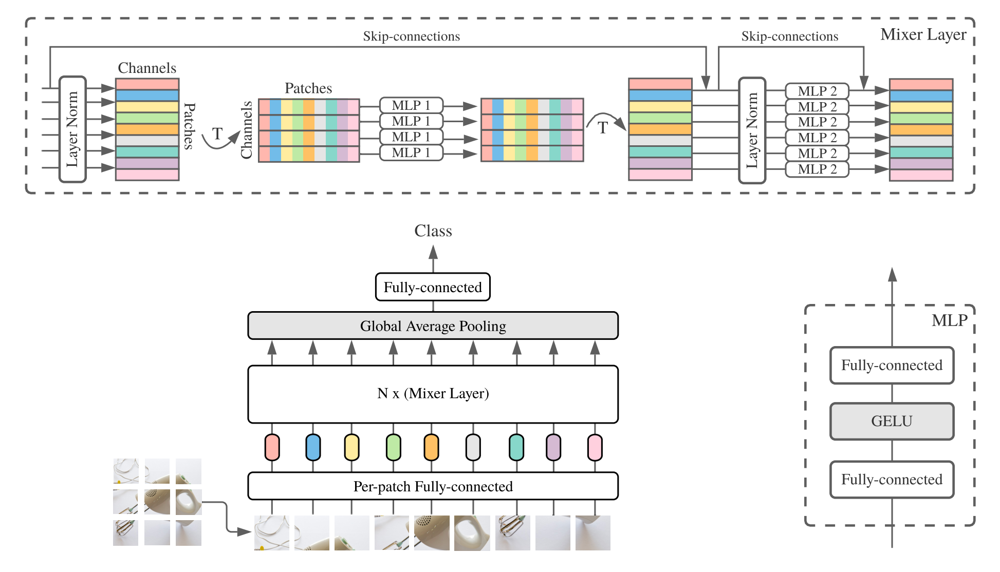

# Vision Transformer 与 MLP-Mixer 架构 (Vision Transformer and MLP-Mixer Architectures)

<p align="center">
  <a href="README.md">English</a> · <b>简体中文</b>
</p>

本仓库开源了来自以下学术论文的模型：

- [An Image is Worth 16x16 Words: Transformers for Image Recognition at Scale](https://arxiv.org/abs/2010.11929)
- [MLP-Mixer: An all-MLP Architecture for Vision](https://arxiv.org/abs/2105.01601)
- [How to train your ViT? Data, Augmentation, and Regularization in Vision Transformers](https://arxiv.org/abs/2106.10270)
- [When Vision Transformers Outperform ResNets without Pretraining or Strong Data Augmentations](https://arxiv.org/abs/2106.01548)
- [LiT: Zero-Shot Transfer with Locked-image text Tuning](https://arxiv.org/abs/2111.07991)
- [Surrogate Gap Minimization Improves Sharpness-Aware Training](https://arxiv.org/abs/2203.08065)

相关模型在 [ImageNet](http://www.image-net.org/) 和 [ImageNet-21k](http://www.image-net.org/) 数据集上进行了预训练。我们提供了基于 [JAX](https://jax.readthedocs.io)/[Flax](http://flax.readthedocs.io) 对开源模型进行微调（Fine-tuning）的代码。

本代码库中的模型最初是在 https://github.com/google-research/big_vision/ 中进行训练的，在那里您可以找到更高级的代码（例如多主机分布式训练），以及部分原始训练脚本（例如用于预训练 ViT 的 [configs/vit_i21k.py](https://github.com/google-research/big_vision/blob/main/big_vision/configs/vit_i21k.py) 或用于模型迁移的 [configs/transfer.py](https://github.com/google-research/big_vision/blob/main/big_vision/configs/transfer.py)）。

目录：

- [Vision Transformer 与 MLP-Mixer 架构](#vision-transformer-and-mlp-mixer-architectures)
	- [Colab 交互教程](#colab)
	- [安装指南](#installation)
	- [模型微调](#fine-tuning-a-model)
	- [Vision Transformer (ViT)](#vision-transformer)
		- [可用 ViT 模型权重](#available-vit-models)
		- [ViT 预期评估结果](#expected-vit-results)
	- [MLP-Mixer](#mlp-mixer)
		- [可用 Mixer 模型权重](#available-mixer-models)
		- [Mixer 预期评估结果](#expected-mixer-results)
	- [LiT 模型](#lit-models)
	- [在云端运行](#running-on-cloud)
		- [创建虚拟机](#create-a-vm)
		- [配置虚拟机](#setup-vm)
	- [BibTeX 引用](#bibtex)
	- [免责声明](#disclaimers)
	- [更新日志](#changelog)

<a id="colab"></a>
## Colab 交互教程 (Colab)

以下 Colab 教程均同时支持 GPU 与 TPU（8 核心，数据并行）。

第一个 Colab 演示了 Vision Transformers 与 MLP Mixers 的 JAX 代码实现。该 Colab 允许您在 Colab 界面中直接编辑仓库文件，并包含详尽的代码注释单元格，逐步引导您浏览代码并与数据进行交互。

https://colab.research.google.com/github/google-research/vision_transformer/blob/main/vit_jax.ipynb

第二个 Colab 允许您探索用于生成第三篇论文《How to train your ViT? ...》数据的 >50k 个 Vision Transformer 及混合架构检查点（Checkpoints）。该 Colab 包含了用于浏览和筛选检查点的代码，并支持使用本仓库的 JAX 代码或流行的 [`timm`] PyTorch 库进行推理（`timm` 也可直接加载这些检查点）。请注意，部分模型还可以直接从 TF-Hub 获取：[sayakpaul/collections/vision_transformer]（由 [Sayak Paul] 提供的社区外部贡献）。

第二个 Colab 还允许您在任意 tfds 数据集或您自己的数据集（以独立 JPEG 文件形式存放，支持可选直接从 Google Drive 读取）上微调检查点。

https://colab.research.google.com/github/google-research/vision_transformer/blob/main/vit_jax_augreg.ipynb

**注意**：截至目前，Google Colab 仅支持单张 GPU（Nvidia Tesla T4），而 TPU（目前为 TPUv2-8）是间接挂载到 Colab 虚拟机上的，通过较慢的网络进行通信，这会导致训练速度受到明显制约。如果您有非微小规模的数据需要微调，通常建议配置一台专用计算机器。详情请参阅[在云端运行](#running-on-cloud)章节。

[`timm`]: https://github.com/rwightman/pytorch-image-models
[sayakpaul/collections/vision_transformer]: https://tfhub.dev/sayakpaul/collections/vision_transformer
[Sayak Paul]: https://github.com/sayakpaul

<a id="installation"></a>
## 安装指南 (Installation)

请确保您的机器上安装了 `Python>=3.10`。

运行以下命令安装 JAX 及 Python 依赖：

```
# 若使用 GPU：
pip install -r vit_jax/requirements.txt

# 若使用 TPU：
pip install -r vit_jax/requirements-tpu.txt
```

对于更高版本的 [JAX](https://github.com/google/jax)，请遵循此处链接的对应仓库中提供的说明。请注意，CPU、GPU 和 TPU 的安装说明略有不同。

安装 [Flaxformer](https://github.com/google/flaxformer)，请遵循此处链接的对应仓库中提供的说明。

更多细节请参阅下方的[在云端运行](#running-on-cloud)章节。

<a id="fine-tuning-a-model"></a>
## 模型微调 (Fine-tuning a model)

您可以在自己感兴趣的数据集上微调下载的模型。所有模型共享相同的命令行接口。

例如，在 CIFAR10 上微调在 imagenet21k 上预训练的 ViT-B/16（请注意我们如何将 `b16,cifar10` 作为参数指定给配置文件，以及我们如何指示代码直接从 GCS 存储桶访问模型，而无需预先下载到本地目录）：

```bash
python -m vit_jax.main --workdir=/tmp/vit-$(date +%s) \
    --config=$(pwd)/vit_jax/configs/vit.py:b16,cifar10 \
    --config.pretrained_dir='gs://vit_models/imagenet21k'
```

若要在 CIFAR10 上微调在 imagenet21k 上预训练的 Mixer-B/16：

```bash
python -m vit_jax.main --workdir=/tmp/vit-$(date +%s) \
    --config=$(pwd)/vit_jax/configs/mixer_base16_cifar10.py \
    --config.pretrained_dir='gs://mixer_models/imagenet21k'
```

论文《How to train your ViT? ...》新增了 >50k 个检查点，您可以使用 [`configs/augreg.py`] 配置进行微调。当您仅指定模型名称（[`configs/model.py`] 中的 `config.name` 值）时，系统会默认选择在上游验证准确率上表现最佳的 i21k 检查点（“推荐”检查点，参见论文第 4.5 节）。为了决定使用哪个模型，请参考论文中的图 3。也可以选择不同的检查点（参见 Colab [`vit_jax_augreg.ipynb`]），然后指定来自 `filename` 或 `adapt_filename` 列的值，这些值对应于 [`gs://vit_models/augreg`] 目录中不含 `.npz` 的文件名。

```bash
python -m vit_jax.main --workdir=/tmp/vit-$(date +%s) \
    --config=$(pwd)/vit_jax/configs/augreg.py:R_Ti_16 \
    --config.dataset=oxford_iiit_pet \
    --config.base_lr=0.01
```

目前，代码会自动下载 CIFAR-10 和 CIFAR-100 数据集。通过使用 [TensorFlow Datasets 库](https://github.com/tensorflow/datasets/)，可以轻松集成其他公开数据集或自定义数据集。请注意，您还需要更新 `vit_jax/input_pipeline.py`，以指定添加的数据集的相关参数。

请注意，我们的代码会默认利用所有可用的 GPU/TPU 进行微调。

若要查看所有可用参数标志的详细列表，请运行 `python3 -m vit_jax.train --help`。

显存与内存相关注意事项：

- 不同的模型需要不同大小的显存。可用显存还取决于加速器的配置（类型和数量）。如果您遇到显存不足（OOM）错误，可以增加 `--config.accum_steps=8` 的值 —— 或者，也可以减小 `--config.batch=512`（并相应调小 `--config.base_lr`）。
- 主机端会在内存中保留一个打乱缓冲区（Shuffle Buffer）。如果您遇到主机端内存 OOM（不同于加速器显存 OOM），可以调小默认的 `--config.shuffle_buffer=50000`。

<a id="vision-transformer"></a>
## Vision Transformer (ViT)

作者：Alexey Dosovitskiy\*†, Lucas Beyer\*, Alexander Kolesnikov\*, Dirk
Weissenborn\*, Xiaohua Zhai\*, Thomas Unterthiner, Mostafa Dehghani, Matthias
Minderer, Georg Heigold, Sylvain Gelly, Jakob Uszkoreit 与 Neil Houlsby\*†。

(\*) 共同技术贡献，(†) 共同项目指导。


模型结构概览：我们将图像切分为固定大小的图像块（Patches），对每个图像块进行线性嵌入（Linear Embedding），添加位置嵌入（Position Embeddings），并将所得的向量序列馈送给标准的 Transformer 编码器。为了执行图像分类任务，我们采用了在序列中添加额外的可学习“分类标记（Classification Token, [CLS]）”的标准方案。

<a id="available-vit-models"></a>
### 可用 ViT 模型权重 (Available ViT models)

我们在不同的 GCS 存储桶中提供了多种 ViT 模型。模型可以通过如下命令下载：

```
wget https://storage.googleapis.com/vit_models/imagenet21k/ViT-B_16.npz
```

模型文件名（不含 `.npz` 扩展名）对应于 [`vit_jax/configs/models.py`] 中的 `config.model_name`：

- [`gs://vit_models/imagenet21k`] - 在 ImageNet-21k 上预训练的模型。
- [`gs://vit_models/imagenet21k+imagenet2012`] - 在 ImageNet-21k 上预训练并在 ImageNet 上微调的模型。
- [`gs://vit_models/augreg`] - 在 ImageNet-21k 上预训练、应用了不同程度 [AugReg] 增强正则化以提升性能的模型。
- [`gs://vit_models/sam`] - 在 ImageNet 上采用 [SAM] 优化预训练的模型。
- [`gs://vit_models/gsam`] - 在 ImageNet 上采用 [GSAM] 优化预训练的模型。

我们推荐使用以下采用 [AugReg] 训练、具有最佳预训练指标的检查点：

|  模型   |                                   预训练检查点                                   |   大小   |                                                       微调检查点                                                        | 分辨率 | 吞吐量 (Img/sec) | ImageNet 准确率 |
| :------- | :----------------------------------------------------------------------------------------- | -------: | :--------------------------------------------------------------------------------------------------------------------------------- | ---------: | ------: | ----------------: |
| L/16     | `gs://vit_models/augreg/L_16-i21k-300ep-lr_0.001-aug_strong1-wd_0.1-do_0.0-sd_0.0.npz`     | 1243 MiB | `gs://vit_models/augreg/L_16-i21k-300ep-lr_0.001-aug_strong1-wd_0.1-do_0.0-sd_0.0--imagenet2012-steps_20k-lr_0.01-res_384.npz`     |        384 |      50 |            85.59% |
| B/16     | `gs://vit_models/augreg/B_16-i21k-300ep-lr_0.001-aug_medium1-wd_0.1-do_0.0-sd_0.0.npz`     |  391 MiB | `gs://vit_models/augreg/B_16-i21k-300ep-lr_0.001-aug_medium1-wd_0.1-do_0.0-sd_0.0--imagenet2012-steps_20k-lr_0.03-res_384.npz`     |        384 |     138 |            85.49% |
| S/16     | `gs://vit_models/augreg/S_16-i21k-300ep-lr_0.001-aug_light1-wd_0.03-do_0.0-sd_0.0.npz`     |  115 MiB | `gs://vit_models/augreg/S_16-i21k-300ep-lr_0.001-aug_light1-wd_0.03-do_0.0-sd_0.0--imagenet2012-steps_20k-lr_0.03-res_384.npz`     |        384 |     300 |            83.73% |
| R50+L/32 | `gs://vit_models/augreg/R50_L_32-i21k-300ep-lr_0.001-aug_medium1-wd_0.1-do_0.1-sd_0.1.npz` | 1337 MiB | `gs://vit_models/augreg/R50_L_32-i21k-300ep-lr_0.001-aug_medium1-wd_0.1-do_0.1-sd_0.1--imagenet2012-steps_20k-lr_0.01-res_384.npz` |        384 |     327 |            85.99% |
| R26+S/32 | `gs://vit_models/augreg/R26_S_32-i21k-300ep-lr_0.001-aug_light1-wd_0.1-do_0.0-sd_0.0.npz`  |  170 MiB | `gs://vit_models/augreg/R26_S_32-i21k-300ep-lr_0.001-aug_light1-wd_0.1-do_0.0-sd_0.0--imagenet2012-steps_20k-lr_0.01-res_384.npz`  |        384 |     560 |            83.85% |
| Ti/16    | `gs://vit_models/augreg/Ti_16-i21k-300ep-lr_0.001-aug_none-wd_0.03-do_0.0-sd_0.0.npz`      |   37 MiB | `gs://vit_models/augreg/Ti_16-i21k-300ep-lr_0.001-aug_none-wd_0.03-do_0.0-sd_0.0--imagenet2012-steps_20k-lr_0.03-res_384.npz`      |        384 |     610 |            78.22% |
| B/32     | `gs://vit_models/augreg/B_32-i21k-300ep-lr_0.001-aug_light1-wd_0.1-do_0.0-sd_0.0.npz`      |  398 MiB | `gs://vit_models/augreg/B_32-i21k-300ep-lr_0.001-aug_light1-wd_0.1-do_0.0-sd_0.0--imagenet2012-steps_20k-lr_0.01-res_384.npz`      |        384 |     955 |            83.59% |
| S/32     | `gs://vit_models/augreg/S_32-i21k-300ep-lr_0.001-aug_none-wd_0.1-do_0.0-sd_0.0.npz`        |  118 MiB | `gs://vit_models/augreg/S_32-i21k-300ep-lr_0.001-aug_none-wd_0.1-do_0.0-sd_0.0--imagenet2012-steps_20k-lr_0.01-res_384.npz`        |        384 |    2154 |            79.58% |
| R+Ti/16  | `gs://vit_models/augreg/R_Ti_16-i21k-300ep-lr_0.001-aug_none-wd_0.03-do_0.0-sd_0.0.npz`    |   40 MiB | `gs://vit_models/augreg/R_Ti_16-i21k-300ep-lr_0.001-aug_none-wd_0.03-do_0.0-sd_0.0--imagenet2012-steps_20k-lr_0.03-res_384.npz`    |        384 |    2426 |            75.40% |

<a id="expected-vit-results"></a>
### ViT 预期评估结果 (Expected ViT results)

原始 ViT 论文 (https://arxiv.org/abs/2010.11929) 中的结果已使用来自 [`gs://vit_models/imagenet21k`] 的模型进行了复现：

| 模型        | 数据集       | dropout=0.0                                                                                                                                                         | dropout=0.1                                                                                                                                                          |
|:-------------|:-------------|:--------------------------------------------------------------------------------------------------------------------------------------------------------------------|:---------------------------------------------------------------------------------------------------------------------------------------------------------------------|
| R50+ViT-B_16 | cifar10      | 98.72%, 3.9h (A100), [tb.dev](https://tensorboard.dev/experiment/nwXQNjudRJW3dtQzhPZwwA/#scalars&regexInput=%5ER50.ViT-B_16/cifar10/do_0.0&_smoothingWeight=0)      | 98.94%, 10.1h (V100), [tb.dev](https://tensorboard.dev/experiment/nwXQNjudRJW3dtQzhPZwwA/#scalars&regexInput=%5ER50.ViT-B_16/cifar10/do_0.1&_smoothingWeight=0)      |
| R50+ViT-B_16 | cifar100     | 90.88%, 4.1h (A100), [tb.dev](https://tensorboard.dev/experiment/nwXQNjudRJW3dtQzhPZwwA/#scalars&regexInput=%5ER50.ViT-B_16/cifar100/do_0.0&_smoothingWeight=0)     | 92.30%, 10.1h (V100), [tb.dev](https://tensorboard.dev/experiment/nwXQNjudRJW3dtQzhPZwwA/#scalars&regexInput=%5ER50.ViT-B_16/cifar100/do_0.1&_smoothingWeight=0)     |
| R50+ViT-B_16 | imagenet2012 | 83.72%, 9.9h (A100), [tb.dev](https://tensorboard.dev/experiment/nwXQNjudRJW3dtQzhPZwwA/#scalars&regexInput=%5ER50.ViT-B_16/imagenet2012/do_0.0&_smoothingWeight=0) | 85.08%, 24.2h (V100), [tb.dev](https://tensorboard.dev/experiment/nwXQNjudRJW3dtQzhPZwwA/#scalars&regexInput=%5ER50.ViT-B_16/imagenet2012/do_0.1&_smoothingWeight=0) |
| ViT-B_16     | cifar10      | 99.02%, 2.2h (A100), [tb.dev](https://tensorboard.dev/experiment/nwXQNjudRJW3dtQzhPZwwA/#scalars&regexInput=%5EViT-B_16/cifar10/do_0.0&_smoothingWeight=0)          | 98.76%, 7.8h (V100), [tb.dev](https://tensorboard.dev/experiment/nwXQNjudRJW3dtQzhPZwwA/#scalars&regexInput=%5EViT-B_16/cifar10/do_0.1&_smoothingWeight=0)           |
| ViT-B_16     | cifar100     | 92.06%, 2.2h (A100), [tb.dev](https://tensorboard.dev/experiment/nwXQNjudRJW3dtQzhPZwwA/#scalars&regexInput=%5EViT-B_16/cifar100/do_0.0&_smoothingWeight=0)         | 91.92%, 7.8h (V100), [tb.dev](https://tensorboard.dev/experiment/nwXQNjudRJW3dtQzhPZwwA/#scalars&regexInput=%5EViT-B_16/cifar100/do_0.1&_smoothingWeight=0)          |
| ViT-B_16     | imagenet2012 | 84.53%, 6.5h (A100), [tb.dev](https://tensorboard.dev/experiment/nwXQNjudRJW3dtQzhPZwwA/#scalars&regexInput=%5EViT-B_16/imagenet2012/do_0.0&_smoothingWeight=0)     | 84.12%, 19.3h (V100), [tb.dev](https://tensorboard.dev/experiment/nwXQNjudRJW3dtQzhPZwwA/#scalars&regexInput=%5EViT-B_16/imagenet2012/do_0.1&_smoothingWeight=0)     |
| ViT-B_32     | cifar10      | 98.88%, 0.8h (A100), [tb.dev](https://tensorboard.dev/experiment/nwXQNjudRJW3dtQzhPZwwA/#scalars&regexInput=%5EViT-B_32/cifar10/do_0.0&_smoothingWeight=0)          | 98.75%, 1.8h (V100), [tb.dev](https://tensorboard.dev/experiment/nwXQNjudRJW3dtQzhPZwwA/#scalars&regexInput=%5EViT-B_32/cifar10/do_0.1&_smoothingWeight=0)           |
| ViT-B_32     | cifar100     | 92.31%, 0.8h (A100), [tb.dev](https://tensorboard.dev/experiment/nwXQNjudRJW3dtQzhPZwwA/#scalars&regexInput=%5EViT-B_32/cifar100/do_0.0&_smoothingWeight=0)         | 92.05%, 1.8h (V100), [tb.dev](https://tensorboard.dev/experiment/nwXQNjudRJW3dtQzhPZwwA/#scalars&regexInput=%5EViT-B_32/cifar100/do_0.1&_smoothingWeight=0)          |
| ViT-B_32     | imagenet2012 | 81.66%, 3.3h (A100), [tb.dev](https://tensorboard.dev/experiment/nwXQNjudRJW3dtQzhPZwwA/#scalars&regexInput=%5EViT-B_32/imagenet2012/do_0.0&_smoothingWeight=0)     | 81.31%, 4.9h (V100), [tb.dev](https://tensorboard.dev/experiment/nwXQNjudRJW3dtQzhPZwwA/#scalars&regexInput=%5EViT-B_32/imagenet2012/do_0.1&_smoothingWeight=0)      |
| ViT-L_16     | cifar10      | 99.13%, 6.9h (A100), [tb.dev](https://tensorboard.dev/experiment/nwXQNjudRJW3dtQzhPZwwA/#scalars&regexInput=%5EViT-L_16/cifar10/do_0.0&_smoothingWeight=0)          | 99.14%, 24.7h (V100), [tb.dev](https://tensorboard.dev/experiment/nwXQNjudRJW3dtQzhPZwwA/#scalars&regexInput=%5EViT-L_16/cifar10/do_0.1&_smoothingWeight=0)          |
| ViT-L_16     | cifar100     | 92.91%, 7.1h (A100), [tb.dev](https://tensorboard.dev/experiment/nwXQNjudRJW3dtQzhPZwwA/#scalars&regexInput=%5EViT-L_16/cifar100/do_0.0&_smoothingWeight=0)         | 93.22%, 24.4h (V100), [tb.dev](https://tensorboard.dev/experiment/nwXQNjudRJW3dtQzhPZwwA/#scalars&regexInput=%5EViT-L_16/cifar100/do_0.1&_smoothingWeight=0)         |
| ViT-L_16     | imagenet2012 | 84.47%, 16.8h (A100), [tb.dev](https://tensorboard.dev/experiment/nwXQNjudRJW3dtQzhPZwwA/#scalars&regexInput=%5EViT-L_16/imagenet2012/do_0.0&_smoothingWeight=0)    | 85.05%, 59.7h (V100), [tb.dev](https://tensorboard.dev/experiment/nwXQNjudRJW3dtQzhPZwwA/#scalars&regexInput=%5EViT-L_16/imagenet2012/do_0.1&_smoothingWeight=0)     |
| ViT-L_32     | cifar10      | 99.06%, 1.9h (A100), [tb.dev](https://tensorboard.dev/experiment/nwXQNjudRJW3dtQzhPZwwA/#scalars&regexInput=%5EViT-L_32/cifar10/do_0.0&_smoothingWeight=0)          | 99.09%, 6.1h (V100), [tb.dev](https://tensorboard.dev/experiment/nwXQNjudRJW3dtQzhPZwwA/#scalars&regexInput=%5EViT-L_32/cifar10/do_0.1&_smoothingWeight=0)           |
| ViT-L_32     | cifar100     | 93.29%, 1.9h (A100), [tb.dev](https://tensorboard.dev/experiment/nwXQNjudRJW3dtQzhPZwwA/#scalars&regexInput=%5EViT-L_32/cifar100/do_0.0&_smoothingWeight=0)         | 93.34%, 6.2h (V100), [tb.dev](https://tensorboard.dev/experiment/nwXQNjudRJW3dtQzhPZwwA/#scalars&regexInput=%5EViT-L_32/cifar100/do_0.1&_smoothingWeight=0)          |
| ViT-L_32     | imagenet2012 | 81.89%, 7.5h (A100), [tb.dev](https://tensorboard.dev/experiment/nwXQNjudRJW3dtQzhPZwwA/#scalars&regexInput=%5EViT-L_32/imagenet2012/do_0.0&_smoothingWeight=0)     | 81.13%, 15.0h (V100), [tb.dev](https://tensorboard.dev/experiment/nwXQNjudRJW3dtQzhPZwwA/#scalars&regexInput=%5EViT-L_32/imagenet2012/do_0.1&_smoothingWeight=0)     |

我们还想强调的是，使用较短的训练周期同样可以取得高质量的结果，并鼓励代码使用者微调超参数以权衡准确率与计算预算。下表中展示了 CIFAR-10/100 数据集的一些示例：

| 上游预训练    | 模型     | 数据集       | 总步数 / 预热步数 (total/warmup) | 准确率   | 训练耗时 (Wall-clock) |                                                                         链接 |
| ----------- | -------- | ------------ | --------------------------- | -------- | --------------- | ---------------------------------------------------------------------------- |
| imagenet21k | ViT-B_16 | cifar10      | 500 / 50                    |   98.59% |             17m | [tensorboard.dev](https://tensorboard.dev/experiment/QgkpiW53RPmjkabe1ME31g/) |
| imagenet21k | ViT-B_16 | cifar10      | 1000 / 100                  |   98.86% |             39m | [tensorboard.dev](https://tensorboard.dev/experiment/w8DQkDeJTOqJW5js80gOQg/) |
| imagenet21k | ViT-B_16 | cifar100     | 500 / 50                    |   89.17% |             17m | [tensorboard.dev](https://tensorboard.dev/experiment/5hM4GrnAR0KEZg725Ewnqg/) |
| imagenet21k | ViT-B_16 | cifar100     | 1000 / 100                  |   91.15% |             39m | [tensorboard.dev](https://tensorboard.dev/experiment/QLQTaaIoT9uEcAjtA0eRwg/) |

<a id="mlp-mixer"></a>
## MLP-Mixer

作者：Ilya Tolstikhin\*, Neil Houlsby\*, Alexander Kolesnikov\*, Lucas Beyer\*,
Xiaohua Zhai, Thomas Unterthiner, Jessica Yung, Andreas Steiner, Daniel Keysers,
Jakob Uszkoreit, Mario Lucic, Alexey Dosovitskiy。

(\*) 共同贡献。



MLP-Mixer（简称 *Mixer*）由逐块线性嵌入（Per-patch linear embeddings）、Mixer 层和分类头组成。Mixer 层包含一个词元混合 MLP（Token-mixing MLP）和一个通道混合 MLP（Channel-mixing MLP），每个 MLP 均由两个全连接层和一个 GELU 非线性激活函数构成。其他组件包括：残差跳跃连接（Skip-connections）、Dropout 和线性分类头。

关于安装，请遵循上述[相同步骤](#installation)。

<a id="available-mixer-models"></a>
### 可用 Mixer 模型权重 (Available Mixer models)

我们提供了在 ImageNet 和 ImageNet-21k 数据集上预训练的 Mixer-B/16 与 Mixer-L/16 模型。详细信息请参阅 Mixer 论文的表 3。所有模型均可在以下地址获取：

https://console.cloud.google.com/storage/mixer_models/

请注意，这些模型也可以直接从 TF-Hub 获取：[sayakpaul/collections/mlp-mixer]（由 [Sayak Paul] 提供的社区外部贡献）。

[sayakpaul/collections/mlp-mixer]: https://tfhub.dev/sayakpaul/collections/mlp-mixer

<a id="expected-mixer-results"></a>
### Mixer 预期评估结果 (Expected Mixer results)

我们在配备 4 块 V100 GPU 的 Google Cloud 计算实例上运行了微调代码，使用了本仓库的默认微调参数。评估结果如下：

上游预训练     | 模型       | 数据集   | 准确率    | 训练耗时 (Wall-clock) | 实验链接
:----------- | :--------- | :------ | -------: | :-------------- | :---
ImageNet     | Mixer-B/16 | cifar10 | 96.72%   | 3.0h            | [tensorboard.dev](https://tensorboard.dev/experiment/j9zCYt9yQVm93nqnsDZayA/)
ImageNet     | Mixer-L/16 | cifar10 | 96.59%   | 3.0h            | [tensorboard.dev](https://tensorboard.dev/experiment/Q4feeErzRGGop5XzAvYj2g/)
ImageNet-21k | Mixer-B/16 | cifar10 | 96.82%   | 9.6h            | [tensorboard.dev](https://tensorboard.dev/experiment/mvP4McV2SEGFeIww20ie5Q/)
ImageNet-21k | Mixer-L/16 | cifar10 | 98.34%   | 10.0h           | [tensorboard.dev](https://tensorboard.dev/experiment/dolAJyQYTYmudytjalF6Jg/)

<a id="lit-models"></a>
## LiT 模型 (LiT models)

有关详细信息，请参阅 Google AI 官方博客文章：[LiT: adding language understanding to image models](http://ai.googleblog.com/2022/04/locked-image-tuning-adding-language.html)，或阅读 CVPR 论文《LiT: Zero-Shot Transfer with Locked-image text Tuning》(https://arxiv.org/abs/2111.07991)。

我们发布了一个在 ImageNet 零样本准确率达到 72.1% 的 Transformer B/16-base 模型，以及一个在 ImageNet 零样本准确率达到 75.7% 的 L/16-large 模型。有关这些模型的更多信息，请参阅 [LiT 模型说明卡 (Model Card)](model_cards/lit.md)。

我们提供了一个包含小型文本编码器的浏览器端交互演示（最小的模型甚至可以在现代智能手机上流畅运行）：

https://google-research.github.io/vision_transformer/lit/

最后还提供了一个配合图像与文本编码器使用 JAX 模型的 Colab：

https://colab.research.google.com/github/google-research/vision_transformer/blob/main/lit.ipynb

请注意，上述模型目前尚未支持多语言输入，但我们正在努力发布此类模型，一旦可用将及时更新本仓库。

本仓库仅包含 LiT 模型的评估代码。您可以在 `big_vision` 仓库中找到训练代码：

https://github.com/google-research/big_vision/tree/main/big_vision/configs/proj/image_text

来自 [`model_cards/lit.md`] 的预期零样本评估结果（请注意，零样本评估与 Colab 中的简化评估略有不同）：

| 模型 | B16B_2 | L16L |
| :--- | ---: | ---: |
| ImageNet 零样本准确率 | 73.9% | 75.7% |
| ImageNet v2 零样本准确率 | 65.1% | 66.6% |
| CIFAR100 零样本准确率 | 79.0% | 80.5% |
| Pets37 零样本准确率 | 83.3% | 83.3% |
| Resisc45 零样本准确率 | 25.3% | 25.6% |
| MS-COCO Captions 图生文检索 | 51.6% | 48.5% |
| MS-COCO Captions 文生图检索 | 31.8% | 31.1% |

<a id="running-on-cloud"></a>
## 在云端运行 (Running on cloud)

虽然上述 [Colab 教程](#colab)对于入门非常方便，但通常情况下您会希望在配备更强加速器的更大型机器上进行训练。

<a id="create-a-vm"></a>
### 创建虚拟机 (Create a VM)

您可以使用以下命令在 Google Cloud 上配置配备 GPU 的虚拟机：

```bash
# 设置以下所有命令所使用的环境变量。
# 请注意，GCP 项目必须已启用结算。
# 关于配备 GPU 的可用可用区列表，请参阅：
# https://cloud.google.com/compute/docs/gpus/gpu-regions-zones
PROJECT=my-awesome-gcp-project  # 项目必须已启用计费。
VM_NAME=vit-jax-vm-gpu
ZONE=europe-west4-b

# 以下设置已针对本仓库进行过验证。您可以选择其他镜像和机型组合，
# 参考对应的 gcloud 命令：
# gcloud compute images list --project ml-images
# gcloud compute machine-types list
# 等。
gcloud compute instances create $VM_NAME \
    --project=$PROJECT --zone=$ZONE \
    --image=c1-deeplearning-tf-2-5-cu110-v20210527-debian-10 \
    --image-project=ml-images --machine-type=n1-standard-96 \
    --scopes=cloud-platform,storage-full --boot-disk-size=256GB \
    --boot-disk-type=pd-ssd --metadata=install-nvidia-driver=True \
    --maintenance-policy=TERMINATE \
    --accelerator=type=nvidia-tesla-v100,count=8

# 连接至虚拟机（在配置和启动机器所需的几分钟之后）。
gcloud compute ssh --project $PROJECT --zone $ZONE $VM_NAME

# 使用完毕后停止虚拟机（停止的虚拟机仅按存储空间计费）。
gcloud compute instances stop --project $PROJECT --zone $ZONE $VM_NAME

# 使用完毕后删除虚拟机（这也会删除虚拟机上存储的所有数据）。
gcloud compute instances delete --project $PROJECT --zone $ZONE $VM_NAME
```

或者，您也可以使用以下类似命令配置挂载了 TPU 的云端虚拟机（以下命令改编自 [TPU 快速入门教程]）：

[TPU 快速入门教程]: https://cloud.google.com/tpu/docs/jax-quickstart-tpu-vm

```bash
PROJECT=my-awesome-gcp-project  # 项目必须已启用计费。
VM_NAME=vit-jax-vm-tpu
ZONE=europe-west4-a

# 初始化配置服务标识所需。
gcloud beta services identity create --service tpu.googleapis.com

# 创建直接挂载了 TPU 的虚拟机。
gcloud alpha compute tpus tpu-vm create $VM_NAME \
    --project=$PROJECT --zone=$ZONE \
    --accelerator-type v3-8 \
    --version tpu-vm-base

# 连接至虚拟机（在配置和启动机器所需的几分钟之后）。
gcloud alpha compute tpus tpu-vm ssh --project $PROJECT --zone $ZONE $VM_NAME

# 使用完毕后停止虚拟机（停止的虚拟机仅按存储空间计费）。
gcloud alpha compute tpus tpu-vm stop --project $PROJECT --zone $ZONE $VM_NAME

# 使用完毕后删除虚拟机（这也会删除虚拟机上存储的所有数据）。
gcloud alpha compute tpus tpu-vm delete --project $PROJECT --zone $ZONE $VM_NAME
```

<a id="setup-vm"></a>
### 配置虚拟机 (Setup VM)

随后克隆本仓库并按常规流程安装依赖（包括支持 TPU 的 `jaxlib`）：

```bash
git clone --depth=1 --branch=master https://github.com/google-research/vision_transformer
cd vision_transformer

# 可选：安装 virtualenv
pip3 install virtualenv
python3 -m virtualenv env
. env/bin/activate
```

如果您连接到配备 GPU 的虚拟机，请运行以下命令安装 JAX 及其他依赖项：

```bash
pip install -r vit_jax/requirements.txt
```

如果您连接到挂载了 TPU 的虚拟机，请运行以下命令安装 JAX 及其他依赖项：

```bash
pip install -r vit_jax/requirements-tpu.txt
```

安装 [Flaxformer](https://github.com/google/flaxformer)，请遵循此处链接的对应仓库中提供的说明。

无论是 GPU 还是 TPU，都可以通过以下命令检查 JAX 是否能够正确连接到挂载的计算加速器：

```bash
python -c 'import jax; print(jax.devices())'
```

最后，执行[模型微调](#fine-tuning-a-model)章节中提及的相应微调命令即可开始训练。

<a id="bibtex"></a>
## BibTeX 引用 (Bibtex)

```
@article{dosovitskiy2020vit,
  title={An Image is Worth 16x16 Words: Transformers for Image Recognition at Scale},
  author={Dosovitskiy, Alexey and Beyer, Lucas and Kolesnikov, Alexander and Weissenborn, Dirk and Zhai, Xiaohua and Unterthiner, Thomas and  Dehghani, Mostafa and Minderer, Matthias and Heigold, Georg and Gelly, Sylvain and Uszkoreit, Jakob and Houlsby, Neil},
  journal={ICLR},
  year={2021}
}

@article{tolstikhin2021mixer,
  title={MLP-Mixer: An all-MLP Architecture for Vision},
  author={Tolstikhin, Ilya and Houlsby, Neil and Kolesnikov, Alexander and Beyer, Lucas and Zhai, Xiaohua and Unterthiner, Thomas and Yung, Jessica and Steiner, Andreas and Keysers, Daniel and Uszkoreit, Jakob and Lucic, Mario and Dosovitskiy, Alexey},
  journal={arXiv preprint arXiv:2105.01601},
  year={2021}
}

@article{steiner2021augreg,
  title={How to train your ViT? Data, Augmentation, and Regularization in Vision Transformers},
  author={Steiner, Andreas and Kolesnikov, Alexander and and Zhai, Xiaohua and Wightman, Ross and Uszkoreit, Jakob and Beyer, Lucas},
  journal={arXiv preprint arXiv:2106.10270},
  year={2021}
}

@article{chen2021outperform,
  title={When Vision Transformers Outperform ResNets without Pretraining or Strong Data Augmentations},
  author={Chen, Xiangning and Hsieh, Cho-Jui and Gong, Boqing},
  journal={arXiv preprint arXiv:2106.01548},
  year={2021},
}

@article{zhuang2022gsam,
  title={Surrogate Gap Minimization Improves Sharpness-Aware Training},
  author={Zhuang, Juntang and Gong, Boqing and Yuan, Liangzhe and Cui, Yin and Adam, Hartwig and Dvornek, Nicha and Tatikonda, Sekhar and Duncan, James and Liu, Ting},
  journal={ICLR},
  year={2022},
}

@article{zhai2022lit,
  title={LiT: Zero-Shot Transfer with Locked-image Text Tuning},
  author={Zhai, Xiaohua and Wang, Xiao and Mustafa, Basil and Steiner, Andreas and Keysers, Daniel and Kolesnikov, Alexander and Beyer, Lucas},
  journal={CVPR},
  year={2022}
}
```

<a id="changelog"></a>
## 更新日志 (Changelog)

按倒序排列：

- 2022-08-18：添加了训练 60k 步（LiT_B16B 为 30k 步）、图像端未加线性头的 LiT-B16B_2 模型（LiT_B16B 包含 768 维线性头），性能更佳。
- 2022-06-09：添加了在 ImageNet 上使用 [GSAM] 从头训练（无需强数据增强）的 ViT 与 Mixer 模型。所得 ViT 表现超越了使用 AdamW 优化器、原始 [SAM] 算法或强数据增强训练的同等尺寸模型。
- 2022-04-14：添加了 [LiT 模型](#lit-models)的模型权重及对应 Colab 演示。
- 2021-07-29：添加了 ViT-B/8 AugReg 模型（3 个上游预训练检查点及其在 224x224 分辨率下的微调权重）。
- 2021-07-02：收录论文《When Vision Transformers Outperform ResNets...》。
- 2021-07-02：添加了采用 [SAM](https://arxiv.org/abs/2010.01412)（锐度感知最小化，Sharpness-Aware Minimization）优化训练的 ViT 和 MLP-Mixer 检查点。
- 2021-06-20：收录论文《How to train your ViT? ...》，并提供了用于探索论文中提及的 >50k 个预训练和微调检查点的全新 Colab。
- 2021-06-18：本代码库进行了重构，全面采用 Flax Linen API 以及 `ml_collections.ConfigDict` 进行配置管理。
- 2021-05-19：随着《How to train your ViT? ...》论文的发表，我们在 ImageNet 和 ImageNet-21k 上添加了超过 50,000 个使用不同程度数据增强和正则化预训练的 ViT 及混合架构模型，并在 ImageNet、Pets37、Kitti-distance、CIFAR-100 和 Resisc45 上提供了微调模型。欢迎查阅 [`vit_jax_augreg.ipynb`] 探索这座庞大的模型宝库！例如，您可以使用该 Colab 获取论文表 3 中 `i21k_300` 列推荐的预训练和微调检查点文件名。
- 2020-12-01：添加了 R50+ViT-B/16 混合模型（以 ResNet-50 作为 Backbone 骨干网络接 ViT-B/16）。在 imagenet21k 上预训练后，该模型以不到 L/16 模型一半的微调计算成本，取得了接近 L/16 模型的顶尖性能。请注意，这里的“R50”针对 B/16 变体进行了适度定制：原始 ResNet-50 包含 [3,4,6,3] 个块，每个块将图像分辨率减半；与 ResNet Stem 结合后将导致图像缩减 32 倍，因此即便 Patch 大小为 (1,1) 也无法再实现 ViT-B/16。为此，我们在 R50+B/16 变体中改为使用 [3,4,9] 个块。
- 2020-11-09：添加了 ViT-L/16 模型。
- 2020-10-29：添加了在 ImageNet-21k 上预训练并在 ImageNet 上以 224x224 分辨率（而非默认的 384x384）微调的 ViT-B/16 和 ViT-L/16 模型。这些模型的名称带有“-224”后缀，其 Top-1 预期准确率分别达到 81.2% 和 82.7%。

<a id="disclaimers"></a>
## 免责声明 (Disclaimers)

开源发布版本由 Andreas Steiner 筹备制作。

注意：本仓库派生并修改自 [google-research/big_transfer](https://github.com/google-research/big_transfer)。

**这不是 Google 的官方产品。**

[GSAM]: https://arxiv.org/abs/2203.08065
[SAM]: https://arxiv.org/abs/2010.01412
[AugReg]: https://arxiv.org/abs/2106.10270

[`vit_jax/configs/models.py`]: https://github.com/google-research/vision_transformer/blob/main/vit_jax/configs/models.py
[`model_cards/lit.md`]: https://github.com/google-research/vision_transformer/blob/main/model_cards/lit.md

[`configs/augreg.py`]: https://github.com/google-research/vision_transformer/blob/main/vit_jax/configs/augreg.py
[`configs/model.py`]: https://github.com/google-research/vision_transformer/blob/main/vit_jax/configs/models.py
[`vit_jax_augreg.ipynb`]: https://colab.research.google.com/github/google-research/vision_transformer/blob/main/vit_jax_augreg.ipynb
[`vit_jax.ipynb`]: https://colab.research.google.com/github/google-research/vision_transformer/blob/main/vit_jax.ipynb

[`gs://vit_models/imagenet21k`]: https://console.cloud.google.com/storage/browser/vit_models/imagenet21k/
[`gs://vit_models/imagenet21k+imagenet2012`]: https://console.cloud.google.com/storage/browser/vit_models/imagenet21k+imagenet2012/
[`gs://vit_models/augreg`]: https://console.cloud.google.com/storage/browser/vit_models/augreg/
[`gs://vit_models/sam`]: https://console.cloud.google.com/storage/browser/vit_models/sam/
[`gs://mixer_models/sam`]: https://console.cloud.google.com/storage/mixer_models/sam/
[`gs://vit_models/gsam`]: https://console.cloud.google.com/storage/browser/vit_models/gsam/
[`gs://mixer_models/gsam`]: https://console.cloud.google.com/storage/mixer_models/gsam/

---

> **翻译说明（Translation Disclaimer）**
> 本文档由社区志愿者（[@JasonYeYuhe](https://github.com/JasonYeYuhe)）人工翻译并维护，旨在降低中文开发者的阅读门槛。最后同步日期：2026年10月19日。若译文与英文原版存在任何出入或滞后，请以 [英文原版 (README.md)](README.md) 为准。欢迎通过 PR 协助改进译文！
